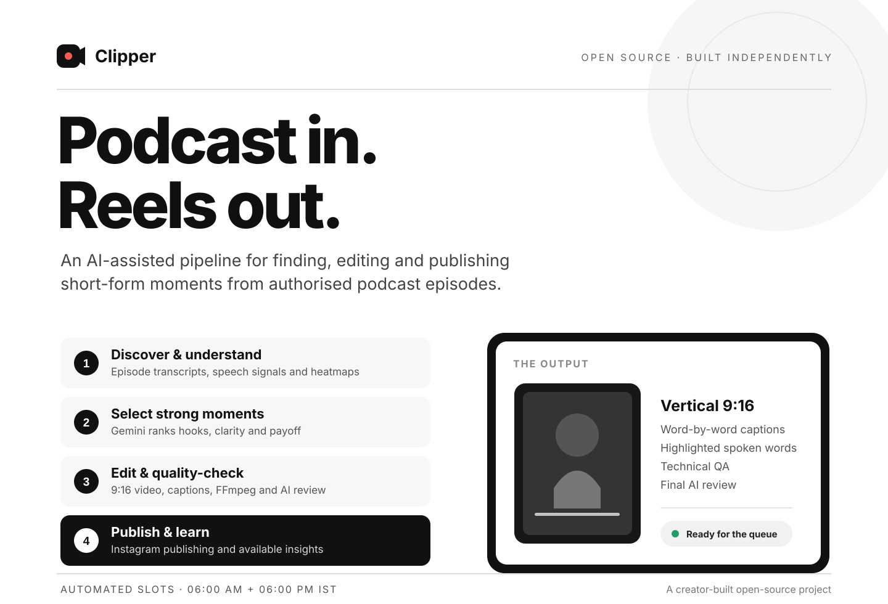
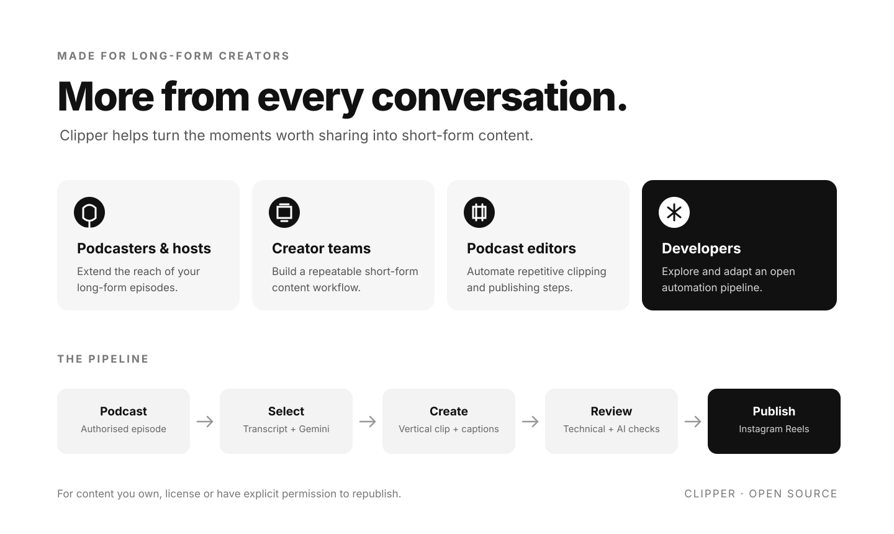

# Clipper

**Turn long-form podcasts into short-form clips — and automate the path to Instagram Reels.**

Clipper is an open-source podcast-to-Reels pipeline I built to find promising moments in authorised podcast episodes, turn them into vertical clips, check their quality, and publish them to Instagram.

It combines transcript analysis, Gemini, video rendering, quality checks and Instagram publishing in one automated workflow.

  

## What Clipper does

Give the pipeline an authorised podcast source. Clipper works through the steps:

1. **Finds moments worth clipping** — analyses episode transcripts, speech signals and YouTube's Most Replayed heatmap when available.
2. **Ranks candidate moments with Gemini** — scores hooks, standalone clarity, payoff, emotion and specificity.
3. **Creates vertical videos** — renders 9:16 clips with word-by-word captions, highlighted spoken words and an on-screen title.
4. **Checks before publishing** — FFmpeg checks for black frames and silence; Gemini reviews the rendered clip. Failed or uncertain clips can be held for manual review.
5. **Publishes and learns** — can publish through the Instagram Graph API and use available Reels insights to guide future source and format choices.

The goal is to reduce repetitive clipping work while keeping quality checks and review safeguards in the loop.

## Who is it for?

- **Podcasters and hosts** who want to repurpose their own long-form episodes.
- **Creators and content teams** managing short-form content for shows they have permission to use.
- **Podcast editors and agencies** looking to automate repetitive selection, captioning, rendering and publishing steps.
- **Developers** who want to explore or adapt an open-source AI-assisted media workflow.

  

## Built around a practical workflow

| Stage | What happens |
|---|---|
| Discover | Checks configured, authorised podcast sources and episode availability. |
| Understand | Uses transcripts, speech signals and heatmap data when available. |
| Select | Gemini ranks candidate moments using editorial criteria. |
| Edit | FFmpeg creates a vertical video with timed captions and a title. |
| Verify | Technical checks and Gemini's final-video review run before publishing. |
| Publish | The Instagram publishing flow attempts to publish eligible clips. |
| Learn | Available Instagram insights help prioritise sources and formats over time. |

## Automatic publishing

The scheduled workflow is configured for:

  <strong>06:00 AM IST</strong> &nbsp; · &nbsp; <strong>06:00 PM IST</strong>

GitHub Actions starts the scheduled runs shortly before each slot. Each run uses the normal pipeline, fills the queue when needed, applies quality and manual-review safeguards, and attempts at most one Reel per slot.

**A scheduled run is an attempt, not a guarantee of a post.** A slot may not publish if no eligible clip is ready, a clip needs review, or an external service such as YouTube or Instagram is unavailable.

## Get it running

1. Fork or clone this repository.
2. Add the required GitHub Actions secrets:
   - **IG_USER_ID** and **IG_ACCESS_TOKEN** — your Instagram Business or Creator publishing credentials.
   - **GEMINI_API_KEY** — for AI-based candidate ranking and final clip review.
   - **YT_COOKIES** and **YT_PROXY** — only if YouTube blocks downloads from your runner.
   - **HF_TOKEN** — optional; used for speaker diarization after accepting the pyannote model conditions.
3. In **Settings → Actions → General**, enable read and write workflow permissions so the workflow can persist its state.
4. In **config.yaml**, enable only podcast sources you own, license or have explicit permission to republish.
5. Run **check-live** first. It checks integrations and rendering, but is diagnostic only — it does not publish a Reel.
6. When setup is ready, use **publish-now** for a manual publishing attempt. Scheduled runs use the normal **tick** pipeline.

## What powers it

- **Python** — pipeline orchestration and state management
- **Gemini** — candidate ranking, caption review and final-video QA
- **yt-dlp** — source episode retrieval
- **FFmpeg** — clip rendering, captions, audio/video processing and technical checks
- **pyannote Community-1** — optional speaker diarization
- **GitHub Actions** — scheduled and manual runs
- **Instagram Graph API** — Reel publishing and available performance insights

## Honest limitations

- Clipper helps rank promising moments; it cannot predict virality or guarantee views.
- Publishing depends on valid credentials, platform availability, source availability and an eligible clip passing review.
- Face tracking helps keep a single visible speaker in frame; it is not face-identity recognition. Diarization does not yet match a voice to a specific face.
- Use only content you own, have licensed, or are explicitly authorised to republish. Having access to a public podcast does not automatically grant reposting rights.

## Help this project reach more creators

If Clipper looks useful, please consider giving the repository a **star**. It is a small action that helps an independently built open-source project get discovered.

**Manifesting 10,000 stars in one month. ⭐**

Explore the code, try it with content you are allowed to use, open an issue, and share what you would improve.

[⭐ Star Clipper on GitHub](https://github.com/Mythesis002/Clipper)

---

  Built independently with curiosity, code and a lot of iteration.

