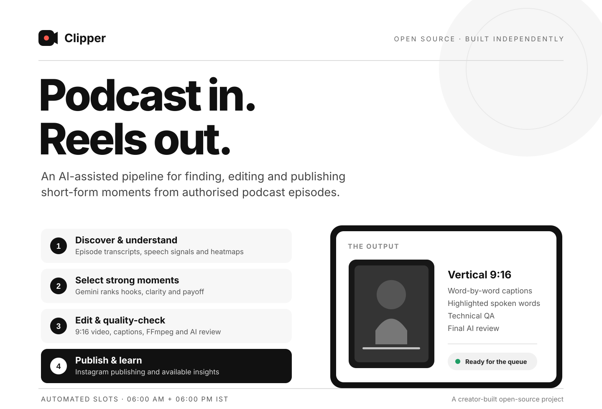
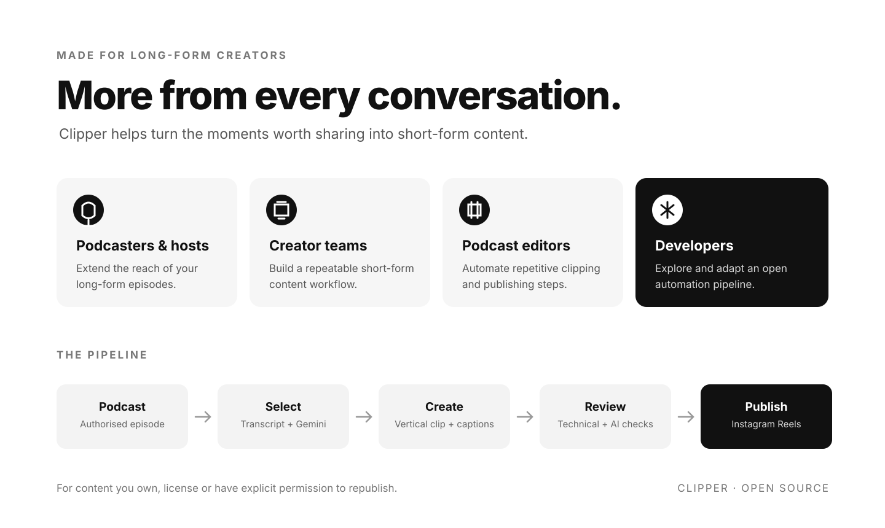

# Clipper

**Turn long-form podcasts into short-form clips — and automate the path to Instagram Reels.**

Clipper is an open-source podcast-to-Reels pipeline I built to find promising moments in authorised podcast episodes, turn them into vertical clips, check their quality, and publish them to Instagram.

It combines transcript analysis, Gemini, video rendering, quality checks and Instagram publishing in one automated workflow.

<p align="center">
  
</p>

## What Clipper does

Give the pipeline an authorised podcast source. Clipper works through the steps:

1. **Finds moments worth clipping** — analyses episode transcripts, speech signals and YouTube's Most Replayed heatmap when available.
2. **Ranks candidate moments with Gemini** — scores hooks, standalone clarity, payoff, emotion and specificity.
3. **Creates vertical videos** — renders 9:16 clips with word-by-word captions, highlighted spoken words and an on-screen title.
4. **Checks before publishing** — FFmpeg checks for black frames and silence; Gemini reviews the rendered clip. Failed or uncertain clips can be held for manual review.
5. **Publishes and learns** — can publish through the Instagram Graph API and use available Reels insights to guide future source and format choices.

The goal is to reduce repetitive clipping work while keeping quality checks and review safeguards in the loop.

## Intelligence layers

Clipper now uses three connected intelligence stages:

- **Editorial intelligence:** Gemini builds a timestamped episode outline, identifies semantic story/idea spans, and evaluates candidates on hook, clarity, payoff, emotion, specificity, curiosity, value and story structure. A separate content-intent classification identifies sponsor reads, affiliate pitches, product pitches and self-promotion. The default `intelligence.promotion_policy: manual_review` holds high-confidence promotional or uncertain classifications for a human decision; it does not automatically reject every product mention.
- **Adaptive editing:** each queued clip receives a validated `edit_plan`. Supported plans adjust caption grouping, caption emphasis, font sizing and restrained motion according to the clip category. The existing face-aware crop and multi-speaker fallback remain in place. The planner does not yet generate B-roll or switch between camera angles; those require licensed assets and reliable active-speaker-to-face association.
- **Self-improvement:** Clipper records compact decisions for candidates considered, stores human feedback, and snapshots available Instagram insights at 24-hour, 72-hour and 7-day maturity bands. Once enough labelled outcomes exist (20 examples, including at least 6 positive and 6 negative), a small regularised local ranker can learn a low-strength preference adjustment. Until then, the existing editorial scoring remains in control.

### Give Clipper editorial feedback

After a clip has a stored clip ID, use **Actions → podcast-clipper → Run workflow**, select `feedback`, provide the clip ID and a label (`good`, `weak`, `needs_context`, `bad_cut`, `promotional`, `visual_issue`, `caption_issue` or `other`). Feedback is stored with the clip and can contribute to future ranker training. Do not label a clip based only on its view count.

The intelligence layers improve the decision process; they cannot guarantee a perfect edit, virality or a successful Instagram post. Review early outputs and retain the publishing safeguards.


## Who is it for?

- **Podcasters and hosts** who want to repurpose their own long-form episodes.
- **Creators and content teams** managing short-form content for shows they have permission to use.
- **Podcast editors and agencies** looking to automate repetitive selection, captioning, rendering and publishing steps.
- **Developers** who want to explore or adapt an open-source AI-assisted media workflow.

<p align="center">
  
</p>

## Built around a practical workflow

| Stage | What happens |
|---|---|
| Discover | Checks configured, authorised podcast sources and episode availability. |
| Understand | Uses transcripts, speech signals and heatmap data when available. |
| Select | Gemini ranks candidate moments using editorial criteria. |
| Edit | FFmpeg creates a vertical video with timed captions and a title. |
| Verify | Technical checks and Gemini's final-video review run before publishing. |
| Publish | The Instagram publishing flow attempts to publish eligible clips. |
| Learn | Available Instagram insights help prioritise sources and formats over time. |

## Automatic publishing

Production scheduling is owned by the PostgreSQL scheduler, not GitHub Actions cron. Each slot stores a UTC instant; schedule rules use the user's IANA timezone and local wall-clock times. Planner and worker services prepare and QA clips before the publish window. The dispatcher performs only the final Instagram media_publish call.

GitHub Actions is manual/CI only. Do not cut over production until the scheduler has been deployed, bootstrapped, and verified with a test account. See [Phase 1 scheduler runbook](docs/phase1_scheduler.md).

**A slot is not silently posted late:** if it exceeds max_late_minutes (default 20), it is marked missed. An ambiguous Instagram publish response becomes publish_uncertain and is never automatically retried.

## Get it running

1. Fork or clone this repository.
2. Add the required GitHub Actions secrets:
   - **IG_USER_ID** and **IG_ACCESS_TOKEN** — your Instagram Business or Creator publishing credentials.
   - **GEMINI_API_KEY** — for AI-based candidate ranking and final clip review.
   - **YT_COOKIES** and **YT_PROXY** — only if YouTube blocks downloads from your runner.
   - **YT_TOKEN_JSON** — Google OAuth authorized-user token JSON for uploading Shorts (see below).
   - **HF_TOKEN** — optional; used for speaker diarization after accepting the pyannote model conditions.
3. In **Settings → Actions → General**, enable read and write workflow permissions so the workflow can persist its state.
4. In **config.yaml**, enable only podcast sources you own, license or have explicit permission to republish. The repository's configured source list is Raj Shamani, Ranveer Allahbadia, Jay Shetty and Prakhar Gupta (Prakhar Ke Pravachan); source permissions are the operator's responsibility and must be verified before enabling each channel.
5. Run **check-live** first. It checks integrations and rendering, but is diagnostic only — it does not publish a Reel.
6. When setup is ready, use **publish-now** for a manual publishing attempt. Scheduled runs use the normal **tick** pipeline.

## YouTube Shorts publishing

Clipper can upload the same final, QA-approved MP4 to YouTube Shorts after Instagram publishing succeeds. The platforms are tracked separately in `state/state.json`: a YouTube failure does not undo an Instagram post or trigger an Instagram repost.

1. In Google Cloud Console, enable **YouTube Data API v3** and complete OAuth consent setup for your Google account.
2. On the trusted machine where your existing `token.pickle` is located, install the Google auth packages and convert it locally:
   ```bash
   pip install google-auth google-auth-oauthlib google-api-python-client
   python -c 'import pickle; from pathlib import Path; c=pickle.load(open("token.pickle", "rb")); Path("youtube-token.json").write_text(c.to_json(), encoding="utf-8")'
   ```
   This conversion assumes the pickle came from your own OAuth login. Never unpickle files from untrusted sources. Do not upload the pickle or client-secret file to GitHub or commit them.
3. Add the resulting authorized-user JSON as the GitHub Actions secret **YT_TOKEN_JSON**. Keep it private; it contains a refresh token.
4. Leave `youtube.enabled: true` in `config.yaml`. Set `privacy_status: unlisted` for a private validation run, or `public` for normal Shorts publishing.

The YouTube upload uses the rendered local MP4, the clip title, the caption/description, and source attribution. YouTube may classify vertical videos under three minutes as Shorts; upload success does not guarantee recommendation or views. Instagram and YouTube publishing outcomes are stored independently.

## What powers it

- **Python** — pipeline orchestration and state management
- **Gemini** — candidate ranking, caption review and final-video QA
- **yt-dlp** — source episode retrieval
- **FFmpeg** — clip rendering, captions, audio/video processing and technical checks
- **pyannote Community-1** — optional speaker diarization
- **GitHub Actions** — scheduled and manual runs
- **Instagram Graph API** — Reel publishing and available performance insights

## Honest limitations

- Clipper helps rank promising moments; it cannot predict virality or guarantee views.
- Publishing depends on valid credentials, platform availability, source availability and an eligible clip passing review.
- Face tracking helps keep a single visible speaker in frame; it is not face-identity recognition. Diarization does not yet match a voice to a specific face.
- Use only content you own, have licensed, or are explicitly authorised to republish. Having access to a public podcast does not automatically grant reposting rights.

## Help this project reach more creators

If Clipper looks useful, please consider giving the repository a **star**. It is a small action that helps an independently built open-source project get discovered.

**Manifesting 10,000 stars in one month. ⭐**

Explore the code, try it with content you are allowed to use, open an issue, and share what you would improve.

[⭐ Star Clipper on GitHub](https://github.com/Mythesis002/Clipper)

---

<p align="center">
  Built independently with curiosity, code and a lot of iteration.
</p>
